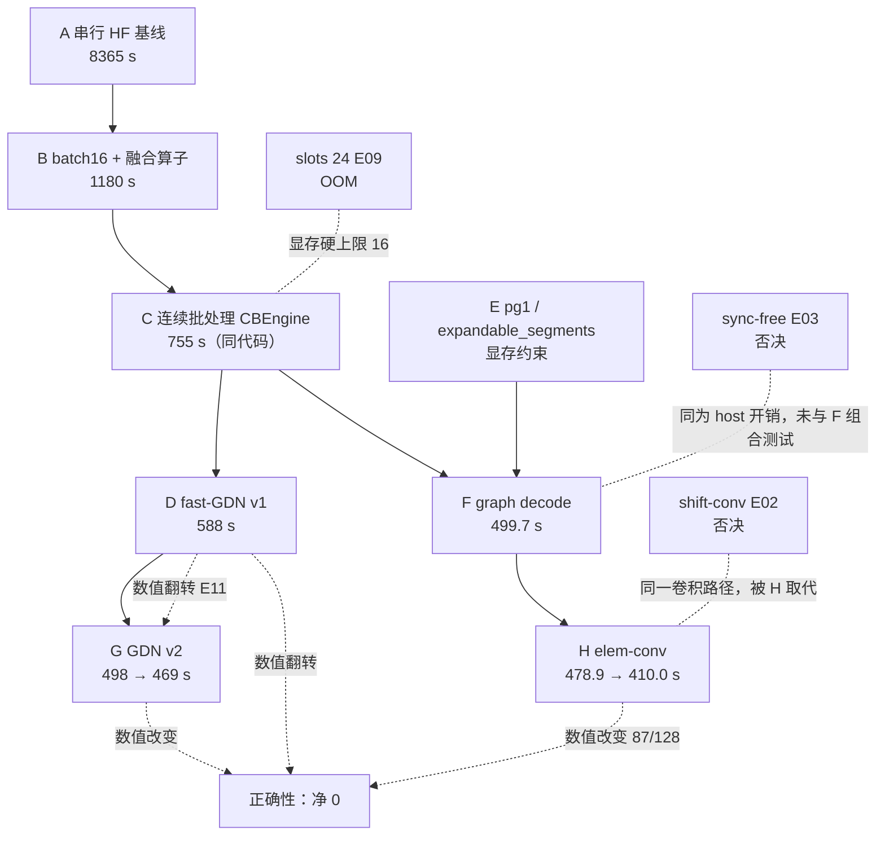

# 优化路径依赖图（去重版）

来源：README.md、HANDOFF.md、experiments/records.jsonl（E01–E21）。同一改动的重复记录已合并。主要用于 Qwen3.5-27B 单卡路径，并标注了迁移到 Gemma-4-26B-A4B 时的适用性。

## 节点

| 节点 | 内容 | 记录 | Qwen3.5 结果 |
|---|---|---|---|
| A | 串行 HF 基线 | E01 | 8365 s |
| B | batch16 + 融合算子（RMSNorm 等） | E01 | 1180 s（无此项 1451 s） |
| C | 连续批处理 CBEngine（slot 制） | E07 | 同代码 755.2 s（pg4） |
| D | fast-GDN chunk v1 | E10, E11 | 588.2 s（同卡 −22%） |
| E | prefill 分组 pg1 / pg4 与 expandable_segments | E06, E14 | 约束节点，本身无收益 |
| F | graph decode（NPUGraph） | E04（诊断）, E12, E13, E18 | 499.7 s（full128） |
| G | GDN v2 批量预计算 | E16, E17 | ABBA 498.4 → 469.5 s |
| H | elem-conv | E05 | ABBA 478.9 → 410.0 s（仅图模式下有收益） |

否决分支（不进主链）：shift-conv（E02）、sync-free（E03）、admission 调整（E08）、24 slots（E09，OOM）、graph bucket 128（E15）、GDN chunk 128（E17）。

## 依赖图

最优配置（Qwen3.5）：C + D + G + F + H + pg1，410.0 s，118/128。

## 关键依赖边

1. F 依赖 C：图捕获要求 CBEngine 使用固定形状的静态 buffer。
2. F 依赖 E：共享内存池，并且需要 `expandable_segments`，否则 pg4 + 图会 OOM（E14）。pg1 与 pg4 在图模式下无差异。
3. H 依赖 F：E05 显示 eager 下 device 时间降 23%，wall 不变；H 的收益只在图模式下出现。
4. G 依赖 D：`gdn_chunk_fast2.py` 复用了 v1 的 `_unit_lower_inv`。
5. 数值改变与正确性：D、G、H 都会产生逐字不一致，正确数持平，但正确题集合有翻转（E11、E05）。

## 失效或需注意的记录

- E18 的结论"replay ≈ device 时间和，故为 device-bound"已被 E04、E05 推翻，不能作为前提。
- E07 的 687.8 s 与 E01 的 1180 s 来自不同代码版本，不可直接比。E06 的 750 与 837 是并发运行，已被 clean run 取代。
- TP=2 是独立分支（E19–E21，12 slots，两张卡，gsm8k longctx 等数据集），与单卡 16-slot 主链不可比（见 FAIRNESS_AUDIT.md）。
- 单卡自研图按 Lmax bucket 捕获，与 vllm-ascend 的 batch 上限（ACL graph batch 8）无关。

## 迁移到 Gemma-4-26B-A4B-it（910B）

模型要点（config.json）：30 层；25 层 sliding_attention（窗口 1024），5 层 full_attention（global_head_dim 512）；MoE，128 experts，top-8，moe_intermediate 704；hidden 2816；vocab 262144；final_logit_softcapping 30。无 GDN、无 conv 状态。

| 节点 | Gemma 适用性 | 说明 |
|---|---|---|
| A 串行基线 | 需要重测 | 先建立 Gemma 的 HF 基线与正确性参考 |
| B 融合算子 | 需要重做 | RMSNorm 的 `(1+w)` 同步问题同样适用；其余算子不同 |
| C 连续批处理 | 适用，需改 | CBEngine 的 KV 按 slot 存放。sliding 层可用 1024 环形缓冲，减少显存 |
| D fast-GDN | 不适用 | Gemma 没有 GDN |
| G GDN v2 | 不适用 | 同上 |
| H elem-conv | 不适用 | Gemma 没有 conv1d；MoE 是新的热点，需要重新 profile |
| E 显存约束 | 需重算 | 权重约 50 GB；KV 形状不同；需要重新做显存探针 |
| F graph decode | 适用但有风险 | MoE 路由通常有数据相关形状，图捕获前需确认 expert 调度是否静态化 |

结论：Qwen 路径的收益主要来自架构（C）和图（F），而 D、G、H 是 GDN 与 conv 专属的，不能照搬。Gemma 的瓶颈很可能在 MoE 路由与派发，需要重新做 E04 式的 wall 分解，而不是假定 host-bound。

## Gemma 的起步顺序（依赖图建议）

1. 重测基线：HF 单卡 B=1 与 batch 的 makespan 与正确性（沿用 fresh-v1 评分与 128 题协议）。
2. wall 分解：分开测 attention、MoE、其他部分的 host 时间与 device 时间（参照 `profile_decode_wall_breakdown.py`）。在没有数据前不做 F。
3. 显存探针：权重、KV（sliding 与 full 分开计算）、prefill 瞬时峰值，给出 slot 上界（参照 E09）。
4. 再决定：若 host 占比高，推进 F；若 MoE 的 device 时间占主导，优先看 expert 计算与通信，而不是派发。
5. C 的移植：CBEngine 去掉 GDN 分支，加入 sliding 环形 KV。
